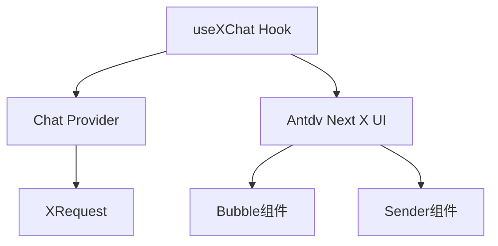

# 🎯 技能定位

> **核心定位**：使用 `useXChat` Hook 构建专业级 AI 对话应用 **前置要求**：已具备自定义 Chat Provider（参考 [x-chat-provider 技能](../x-chat-provider)）

## 目录导航

- [🚀 快速开始](#-快速开始)
  - [依赖管理](#1-依赖管理)
  - [三步集成](#2-三步集成)
- [🧩 核心概念](#-核心概念)
  - [技术栈架构](#技术栈架构)
  - [数据模型](#数据模型)
- [🔧 核心功能详解](#-核心功能详解)
  - [消息管理](#1-消息管理)
  - [请求控制](#2-请求控制)
  - [错误处理](#3-错误处理)
  - [多会话管理](#4-多会话管理)
- [📋 使用前提和依赖](#-使用前提和依赖)
- [🚨 开发规则](#-开发规则)
- [🔗 参考资源](#-参考资源)

# 🚀 快速开始

## 1. 依赖管理

| 包                    | 版本要求  | 用途                                           |
| --------------------- | --------- | ---------------------------------------------- |
| **@antdv-next/x-sdk** | `>=0.0.4` | `useXChat`、`useXConversations`、各类 Provider |
| **@antdv-next/x**     | 最新版    | UI 组件（Bubble、Sender 等）                   |

```bash
npm install @antdv-next/x-sdk @antdv-next/x
```

## 2. 三步集成

### 步骤1：准备 Provider

这部分由 x-chat-provider 技能负责。传给 Provider 的 XRequest 必须使用 `manual: true`，否则 `AbstractChatProvider` 会抛出 `request must be manual`。

```ts
import { XRequest } from "@antdv-next/x-sdk";

import { MyChatProvider } from "./MyChatProvider";

const provider = new MyChatProvider({
  // Provider 场景必须设置 manual: true
  request: XRequest("https://your-api.com/chat", { manual: true }),
});
```

### 步骤2：基础使用

```tsx
import { useXChat } from "@antdv-next/x-sdk";
import { defineComponent } from "vue";

const ChatComponent = defineComponent(() => {
  const { messages, onRequest, isRequesting } = useXChat({
    provider,
    // 请求进行中显示占位消息。
    requestPlaceholder: {
      content: "正在思考中...",
      role: "assistant",
      timestamp: Date.now(),
    },
    // 请求失败时显示兜底消息。
    requestFallback: (_, { error, errorInfo, messageInfo }) => {
      if (error.name === "AbortError") {
        return {
          content: messageInfo?.message?.content || "已取消回复",
          role: "assistant" as const,
          timestamp: Date.now(),
        };
      }
      return {
        content: errorInfo?.error?.message || "网络异常，请稍后重试",
        role: "assistant" as const,
        timestamp: Date.now(),
      };
    },
  });

  return () => (
    <div>
      {messages.value.map(msg => (
        <div key={msg.id}>
          {msg.message.role}: {msg.message.content}
        </div>
      ))}
      <button
        disabled={isRequesting.value}
        onClick={() => onRequest({ query: "你好" })}
      >
        发送
      </button>
    </div>
  );
});
```

### 步骤3：UI集成

`BubbleList` 需要的是 `BubbleItemType[]`，不是 `MessageInfo[]`，传入前先做映射。Vue 中导出的组件是 `BubbleList`，不存在 `Bubble.List`。

```tsx
import { BubbleList, Sender } from "@antdv-next/x";
import { useXChat } from "@antdv-next/x-sdk";
import { computed, defineComponent } from "vue";

const ChatUI = defineComponent(() => {
  const { messages, onRequest, isRequesting, abort } = useXChat({ provider });

  const bubbleItems = computed(() =>
    messages.value.map(({ id, message, status }) => ({
      key: id,
      role: message.role,
      content: message.content,
      loading: status === "loading",
    })),
  );

  return () => (
    <div style={{ height: "600px" }}>
      <BubbleList
        items={bubbleItems.value}
        role={{
          user: { placement: "end" },
          assistant: { placement: "start" },
        }}
      />
      <Sender
        loading={isRequesting.value}
        onSubmit={content => onRequest({ query: content })}
        onCancel={abort}
      />
    </div>
  );
});
```

# 🧩 核心概念

## 技术栈架构



### 数据模型

> ⚠️ **重要提醒**：`messages` 类型是 `Ref<MessageInfo<MessageType>[]>`，不是直接的 `MessageType`。通过 `messages.value` 访问。

```ts
interface MessageInfo<Message> {
  id: number | string; // 消息唯一标识
  message: Message; // 实际消息内容
  status: MessageStatus; // 发送状态
  extraInfo?: AnyObject; // 每次请求的扩展信息
}

// 消息状态
type MessageStatus =
  "local" | "loading" | "updating" | "success" | "error" | "abort";
```

# 🔧 核心功能详解

> 💡 **提示**：API可能会随版本更新，建议查看[官方文档](https://github.com/antdv-next/x/blob/main/packages/docs/src/pages/sdk/use-x-chat.zh-CN.md)获取最新信息

核心功能参考内容 [CORE.md](reference/CORE.md)

## 4. 多会话管理

`useXChat` 按 `conversationKey` 隔离消息 store。会话列表交给同包的 `useXConversations`，再把当前激活的 key 传给 `useXChat`：

```ts
import { useXChat, useXConversations } from "@antdv-next/x-sdk";

const {
  conversations,
  activeConversationKey,
  addConversation,
  removeConversation,
} = useXConversations({
  defaultConversations: [{ key: "1", label: "新会话" }],
  defaultActiveConversationKey: "1",
});

const { messages, onRequest, queueRequest } = useXChat({
  provider,
  conversationKey: activeConversationKey,
});
```

- `conversationKey` 支持 ref；切换 ref 会自动切换消息 store。
- 异步 `defaultMessages` 尚未加载完就想发送时，调用 `queueRequest(conversationKey, params)`，请求会在加载完成后执行。
- `useXConversations` 还提供 `setActiveConversationKey`、`setConversation`、`getConversation`、`setConversations` 和 `getMessages`。

# 📋 使用前提和依赖

## ⚠️ 重要依赖

**use-x-chat 必须依赖以下技能之一：**

| 依赖类型     | 技能                | 说明                                                                 | 是否必须 |
| ------------ | ------------------- | -------------------------------------------------------------------- | -------- |
| **核心依赖** | **x-chat-provider** | 提供自定义 Provider 实例，默认使用 XRequest, **必须**配合 use-x-chat | **必须** |
| **或**       | **内置 Provider**   | OpenAI/DeepSeek 等内置 Provider，默认使用 XRequest                   | **必须** |
| **推荐依赖** | **x-request**       | 配置请求参数和认证，作为默认请求方式                                 | **推荐** |

## 🎯 使用场景对照表

| 使用场景         | 需要的技能组合                           | 使用顺序               |
| ---------------- | ---------------------------------------- | ---------------------- |
| **私有API适配**  | x-chat-provider → use-x-chat             | 先创建Provider，再使用 |
| **标准API使用**  | use-x-chat（内置Provider）               | 直接使用               |
| **需要认证配置** | x-request → use-x-chat                   | 先配置请求，再使用     |
| **完整自定义**   | x-chat-provider → x-request → use-x-chat | 完整工作流             |

# 🚨 开发规则

## 使用 use-x-chat 前必须确认：

- [ ] **已有 Provider 来源**（以下二选一）：
  - [ ] 已用 **x-chat-provider** 创建自定义 Provider
  - [ ] 决定使用内置 Provider（OpenAI/DeepSeek）
- [ ] 已安装 @antdv-next/x-sdk
- [ ] 已了解 MessageInfo 数据结构
- [ ] 已准备好 UI 组件

### 测试用例规则

- **如果用户没有明确需要测试用例，则不要添加测试文件**
- **仅在用户明确要求时才创建测试用例**

### 代码质量规则

- **完成编写后必须检查类型**：运行 `tsc --noEmit` 确保无类型错误
- **保持代码整洁**：移除所有未使用的变量和导入

# 🔗 参考资源

## 📚 核心参考文档

- [API.md](reference/API.md) - 完整 API、返回值、`MessageInfo`、`useXConversations`
- [EXAMPLES.md](reference/EXAMPLES.md) - 实战示例代码

## 🌐 SDK官方文档

- [useXChat 官方文档](https://github.com/antdv-next/x/blob/main/packages/docs/src/pages/sdk/use-x-chat.zh-CN.md)
- [useXConversations 官方文档](https://github.com/antdv-next/x/blob/main/packages/docs/src/pages/sdk/use-x-conversations.zh-CN.md)
- [XRequest 官方文档](https://github.com/antdv-next/x/blob/main/packages/docs/src/pages/sdk/x-request.zh-CN.md)
- [Chat Provider 官方文档](https://github.com/antdv-next/x/blob/main/packages/docs/src/pages/sdk/chat-provider.zh-CN.md)

## 💻 示例代码

- [useXChat 示例](https://github.com/antdv-next/x/tree/main/packages/docs/src/pages/sdk/demo) - 完整示例 demo
