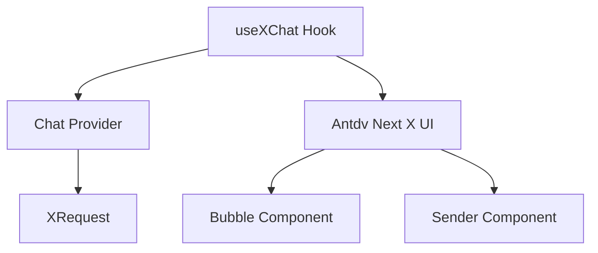

# 🎯 Skill Positioning

> **Core Positioning**: Use the `useXChat` Hook to build professional AI conversation applications. **Prerequisite**: Already have a custom Chat Provider (refer to [x-chat-provider skill](../x-chat-provider))

## Table of Contents

- [🚀 Quick Start](#-quick-start)
  - [Dependency Management](#1-dependency-management)
  - [Three-step Integration](#2-three-step-integration)
- [🧩 Core Concepts](#-core-concepts)
  - [Technology Stack Architecture](#technology-stack-architecture)
  - [Data Model](#data-model)
- [🔧 Core Function Details](#-core-function-details)
  - [Message Management](#1-message-management)
  - [Request Control](#2-request-control)
  - [Error Handling](#3-error-handling)
  - [Multi-conversation Management](#4-multi-conversation-management)
- [📋 Prerequisites and Dependencies](#-prerequisites-and-dependencies)
- [🚨 Development Rules](#-development-rules)
- [🔗 Reference Resources](#-reference-resources)

# 🚀 Quick Start

## 1. Dependency Management

| Package               | Version Requirement | Purpose                                    |
| --------------------- | ------------------- | ------------------------------------------ |
| **@antdv-next/x-sdk** | `>=0.0.4`           | `useXChat`, `useXConversations`, providers |
| **@antdv-next/x**     | latest              | UI components (Bubble, Sender, ...)        |

```bash
npm install @antdv-next/x-sdk @antdv-next/x
```

## 2. Three-step Integration

### Step 1: Prepare Provider

This part is handled by the x-chat-provider skill. The XRequest instance passed to a Provider must use `manual: true`; otherwise `AbstractChatProvider` throws `request must be manual`.

```ts
import { XRequest } from "@antdv-next/x-sdk";

import { MyChatProvider } from "./MyChatProvider";

const provider = new MyChatProvider({
  // manual: true is required for Provider usage
  request: XRequest("https://your-api.com/chat", { manual: true }),
  // When requestPlaceholder is set, a placeholder message is shown before the request starts
  requestPlaceholder: {
    content: "Thinking...",
    role: "assistant",
    timestamp: Date.now(),
  },
  // When requestFallback is set, a fallback message is shown when the request fails
  requestFallback: (_, { error, errorInfo, messageInfo }) => {
    if (error.name === "AbortError") {
      return {
        content: messageInfo?.message?.content || "Reply cancelled",
        role: "assistant" as const,
        timestamp: Date.now(),
      };
    }
    return {
      content:
        errorInfo?.error?.message || "Network error, please try again later",
      role: "assistant" as const,
      timestamp: Date.now(),
    };
  },
});
```

### Step 2: Basic Usage

```tsx
import { useXChat } from "@antdv-next/x-sdk";
import { defineComponent } from "vue";

const ChatComponent = defineComponent(() => {
  const { messages, onRequest, isRequesting } = useXChat({ provider });

  return () => (
    <div>
      {messages.value.map(msg => (
        <div key={msg.id}>
          {msg.message.role}: {msg.message.content}
        </div>
      ))}
      <button
        disabled={isRequesting.value}
        onClick={() => onRequest({ query: "Hello" })}
      >
        Send
      </button>
    </div>
  );
});
```

### Step 3: UI Integration

`BubbleList` expects `BubbleItemType[]`, not `MessageInfo[]`; map the message list before passing it. The exported component is `BubbleList` (there is no `Bubble.List` in Vue).

```tsx
import { BubbleList, Sender } from "@antdv-next/x";
import { useXChat } from "@antdv-next/x-sdk";
import { computed, defineComponent } from "vue";

const ChatUI = defineComponent(() => {
  const { messages, onRequest, isRequesting, abort } = useXChat({ provider });

  const bubbleItems = computed(() =>
    messages.value.map(({ id, message, status }) => ({
      key: id,
      role: message.role,
      content: message.content,
      loading: status === "loading",
    })),
  );

  return () => (
    <div style={{ height: "600px" }}>
      <BubbleList
        items={bubbleItems.value}
        role={{
          user: { placement: "end" },
          assistant: { placement: "start" },
        }}
      />
      <Sender
        loading={isRequesting.value}
        onSubmit={content => onRequest({ query: content })}
        onCancel={abort}
      />
    </div>
  );
});
```

# 🧩 Core Concepts

## Technology Stack Architecture



### Data Model

> ⚠️ **Important Reminder**: `messages` type is `Ref<MessageInfo<MessageType>[]>`, not direct `MessageType`. Access via `messages.value`.

```ts
interface MessageInfo<Message> {
  id: number | string; // Message unique identifier
  message: Message; // Actual message content
  status: MessageStatus; // Sending status
  extraInfo?: AnyObject; // Extra per-request information
}

// Message status
type MessageStatus =
  "local" | "loading" | "updating" | "success" | "error" | "abort";
```

# 🔧 Core Function Details

> 💡 **Tip**: API may update with versions, it is recommended to check [official documentation](https://github.com/antdv-next/x/blob/main/packages/docs/src/pages/sdk/use-x-chat.en-US.md) for the latest information

Core functionality reference content [CORE.md](reference/CORE.md)

## 4. Multi-conversation Management

`useXChat` keeps one message store per `conversationKey`. Manage the conversation list with `useXConversations` from the same package, then pass its active key to `useXChat`:

```ts
import { useXChat, useXConversations } from "@antdv-next/x-sdk";

const {
  conversations,
  activeConversationKey,
  addConversation,
  removeConversation,
} = useXConversations({
  defaultConversations: [{ key: "1", label: "New conversation" }],
  defaultActiveConversationKey: "1",
});

const { messages, onRequest, queueRequest } = useXChat({
  provider,
  conversationKey: activeConversationKey,
});
```

- `conversationKey` accepts a ref; changing it switches the message store automatically.
- Call `queueRequest(conversationKey, params)` when you need to send before async `defaultMessages` have loaded; the request runs after they settle.
- `useXConversations` also exposes `setActiveConversationKey`, `setConversation`, `getConversation`, `setConversations`, and `getMessages`.

# 📋 Prerequisites and Dependencies

## ⚠️ Important Dependencies

**use-x-chat must depend on one of the following skills:**

| Dependency Type            | Skill                 | Description                                                                                | Required        |
| -------------------------- | --------------------- | ------------------------------------------------------------------------------------------ | --------------- |
| **Core Dependency**        | **x-chat-provider**   | Provides custom Provider instance, default uses XRequest, **must** be used with use-x-chat | **Required**    |
| **Or**                     | **Built-in Provider** | OpenAI/DeepSeek and other built-in Providers, default uses XRequest                        | **Required**    |
| **Recommended Dependency** | **x-request**         | Configure request parameters and authentication, as the default request method             | **Recommended** |

## 🎯 Usage Scenario Comparison Table

| Usage Scenario                          | Required Skill Combination               | Usage Order                       |
| --------------------------------------- | ---------------------------------------- | --------------------------------- |
| **Private API Adaptation**              | x-chat-provider → use-x-chat             | Create Provider first, then use   |
| **Standard API Usage**                  | use-x-chat (built-in Provider)           | Direct use                        |
| **Authentication Configuration Needed** | x-request → use-x-chat                   | Configure request first, then use |
| **Complete Customization**              | x-chat-provider → x-request → use-x-chat | Complete workflow                 |

# 🚨 Development Rules

## Before using use-x-chat, must confirm:

- [ ] **Has Provider source** (choose one of the following):
  - [ ] Has created custom Provider with **x-chat-provider**
  - [ ] Decided to use built-in Provider (OpenAI/DeepSeek)
- [ ] @antdv-next/x-sdk is installed
- [ ] Understand MessageInfo data structure
- [ ] UI components are ready

### Test Case Rules

- **If the user does not explicitly need test cases, do not add test files**
- **Only create test cases when the user explicitly requests them**

### Code Quality Rules

- **After completion, must check types**: Run `tsc --noEmit` to ensure no type errors
- **Keep code clean**: Remove all unused variables and imports

# 🔗 Reference Resources

## 📚 Core Reference Documentation

- [API.md](reference/API.md) - Complete API reference, return values, `MessageInfo`, `useXConversations`
- [EXAMPLES.md](reference/EXAMPLES.md) - Practical example code

## 🌐 SDK Official Documentation

- [useXChat Official Documentation](https://github.com/antdv-next/x/blob/main/packages/docs/src/pages/sdk/use-x-chat.en-US.md)
- [useXConversations Official Documentation](https://github.com/antdv-next/x/blob/main/packages/docs/src/pages/sdk/use-x-conversations.en-US.md)
- [XRequest Official Documentation](https://github.com/antdv-next/x/blob/main/packages/docs/src/pages/sdk/x-request.en-US.md)
- [Chat Provider Official Documentation](https://github.com/antdv-next/x/blob/main/packages/docs/src/pages/sdk/chat-provider.en-US.md)

## 💻 Example Code

- [useXChat demos](https://github.com/antdv-next/x/tree/main/packages/docs/src/pages/sdk/demo) - Complete example demos
